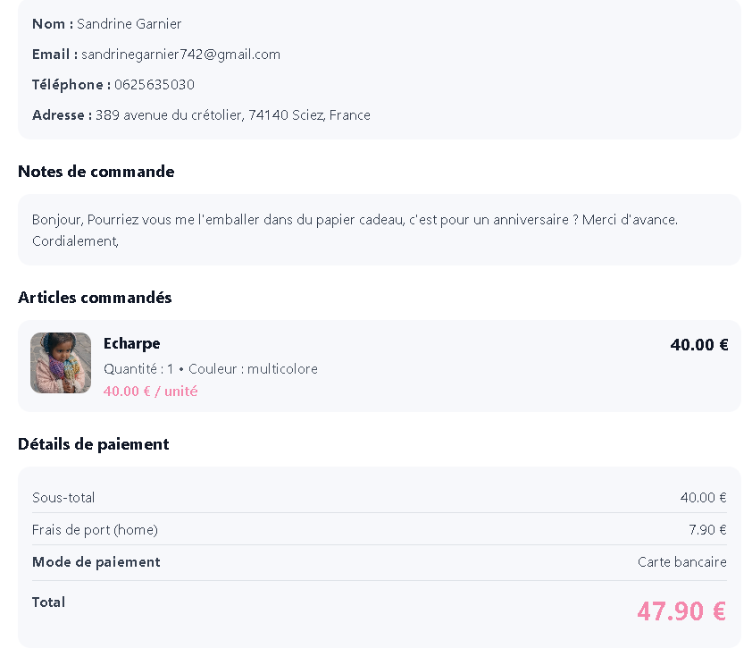

# Liste de tâches du projet

## Légende des statuts
- ✅ Terminé
- 🟡 En cours / à valider
- 🔴 À faire

---

## 1. Administration et navigation admin

### 1.1 Navigation pour les comptes admin
- ✅ Navbar admin avec accès à l’accueil, la boutique, le stock, les commandes et les fiches clients.
- ✅ Permettre à l’admin de naviguer sur le site comme un client tout en gardant un accès clair à l’espace de gestion.
- ✅ Définir le comportement global selon le rôle connecté : visiteur, client, admin.

### 1.2 Navigation cohérente avec l’état de connexion
- ✅ Affichage des liens adapté selon le rôle.
- ✅ Vérifier les redirections après connexion admin.
- ✅ Vérifier les parcours :
  - `/administration`
  - `/administration/stock`
  - `/administration/commandes`
  - `/administration/clients`

### 1.3 Finaliser l’administration
- ✅ Consolider la page stock (harmonisation visuelle globale avec les autres pages admin).
- ✅ Vérifier les actions admin sur produits actifs / archivés.
- ✅ Finaliser la page `/administration/clients`.
- ✅ Harmoniser visuellement les pages admin existantes.
- ✅ Corriger la logique de stock partagée pour gérer correctement les déclinaisons couleur partout.
- ✅ Mieux intégrer les demandes de réassort dans l’admin stock.

---

## 2. Produits, stock et promotions

### 2.1 Prix promo dans l’administration produit
- ✅ Ajouter un champ `prix promo` à droite du prix dans le formulaire produit.
- ✅ Définir si la valeur est optionnelle et comment elle est stockée en base.
- ✅ Vérifier l’impact sur la création, l’édition, l’affichage admin et les API produits.

### 2.2 Affichage promo côté front
- ✅ Afficher le prix normal barré et le prix promo quand un prix promo est renseigné.
- ✅ Vérifier cet affichage sur la page boutique, la fiche produit et toutes les cartes produit concernées.
- ✅ S’assurer que les calculs restent cohérents partout.

### 2.3 Filtre “prix promo” sur la boutique
- ✅ Permettre de filtrer uniquement les produits en promotion.
- ✅ Vérifier la compatibilité avec les autres filtres existants.
- ✅ Valider définitivement si le filtrage reste dynamique ou passe par un bouton d’application global.

### 2.4 Variantes couleur et galerie produit
- ✅ Permettre l’ajout au panier par couleur sur la fiche produit.
- ✅ Associer l’image de variante à la couleur sélectionnée.
- ✅ Permettre de revenir à la photo générique sans casser la fiche produit.
- ✅ Empêcher l’ajout au panier tant qu’aucune couleur n’est choisie sur un produit à variantes.
- ✅ Garder un état “En stock” au niveau produit quand au moins une couleur est disponible.
- ✅ Vérifier la cohérence complète de l’affichage variante/couleur sur le drawer panier.
- ✅ Vérifier la cohérence complète de l’affichage variante/couleur sur la page `/panier`.

### 2.5 Réassort et notifications email
- ✅ Valider le tunnel complet “Me prévenir quand disponible” → demande enregistrée → admin stock → “Notifier maintenant”
- ✅ Vérifier l’envoi réel des notifications de retour en stock sur différentes messageries, dont Gmail
- ✅ Clarifier la règle métier : notifier immédiatement à la remise en stock ou uniquement via action admin “Notifier maintenant”
- ✅ Vérifier qu’une même demande de réassort n’est pas notifiée plusieurs fois après envoi

### 2.6 Réassort par couleur
- ✅ Définir la règle métier des demandes de réassort au niveau couleur pour les produits à variantes :
- ✅ Permettre une demande distincte par couple produit / couleur / email.
- ✅ Empêcher les doublons uniquement pour une même demande active sur le même produit, la même couleur et la même adresse e-mail.
- ✅ Ajouter la couleur concernée dans le modèle `RestockRequest`.
- ✅ Adapter l’API de demande de réassort pour enregistrer la couleur sélectionnée.
- ✅ Faire apparaître le bouton de demande de notification quand la couleur sélectionnée est épuisée
- ✅ Permettre l’affichage du bouton “Me prévenir quand disponible” pour une couleur épuisée même si d’autres couleurs du produit sont encore en stock.
- ✅ Définir clairement le comportement UI quand une couleur est épuisée : couleur désactivée seule, couleur sélectionnable avec état “rupture”, ou action dédiée de demande de réassort.
- ✅ Vérifier le comportement si aucune couleur n’est sélectionnée au moment de la demande.
- ✅ Afficher la couleur demandée dans l’administration / stock avec les demandes de réassort.
- ✅ Adapter l’action “Notifier maintenant” pour notifier la bonne couleur uniquement.
- ✅ Adapter le contenu de l’email de retour en stock pour mentionner la couleur concernée.
- ✅ Vérifier qu’une notification envoyée pour une couleur ne clôture pas par erreur les demandes des autres couleurs du même produit.
- ✅ Corriger l'erreur "Merci de sélectionner une couleur." lorsqu'il n'y en a qu'une
→ OK : on filtre les couleurs archivées, on gère le cas “une seule couleur active” et la logique de sélection automatique dans la fiche produit.
- ✅ Cohérence d’affichage entre fiche produit, drawer panier et page panier
→ OK : même couleur, même image, mêmes quantités, les couleurs archivées ne se retrouvent plus dans le tunnel d’achat.
- ✅ Ajouter la couleur concernée dans le modèle RestockRequest (si pas déjà fait partout).
- ✅ Adapter l’API de demande de réassort pour enregistrer la couleur sélectionnée.
- ✅ Vérifier le comportement si une même adresse demande plusieurs couleurs d’un même produit.
- ✅ Vérifier le comportement si une couleur revient en stock puis retombe à zéro.
- ✅ Vérifier tous les comportements de notification / DMARC / Gmail autour des demandes de réassort par couleur.
- ✅ Archiver les couleurs en remplacement de la suppression.

---

## 3. Paiement et commandes

### 3.1 Intégration Stripe
- ✅ Intégrer les clés de test dans les variables d’environnement locales.
- ✅ Vérifier que la clé secrète est utilisée uniquement côté serveur.
- ✅ Configurer les URLs de retour `success` et `cancel` cohérentes avec `/panier`.
- ✅ Créer le webhook Stripe de test.
- ✅ Écouter au minimum `checkout.session.completed`.
- ✅ Vérifier qu’un paiement test Stripe redirige correctement vers le site.

### 3.2 Stockage des commandes
- ✅ Brancher la création de commande via le webhook Stripe.
- ✅ Enregistrer les lignes produits (quantité, prix unitaire, total, image).
- ✅ Lier la commande à l’utilisateur connecté.
- ✅ Éviter les doublons si Stripe renvoie plusieurs événements.
- ✅ Tester qu’une commande validée crée bien une entrée MongoDB exploitable.
- ✅ Rendre persistant le changement de statut des commandes depuis /administration/commandes
- 🟡 Ajouter plus tard une vraie édition du suivi (trackingNumber / trackingUrl) côté admin, avec éventuellement des règles simples (par exemple : proposer d’ajouter un numéro de suivi quand on passe à “Expédiée”).

### 3.3 Simulation d’achat de bout en bout
- ✅ Se connecter avec un compte utilisateur de test.
- ✅ Vérifier l’ajout au panier, l’accès à `/panier` et à `/mon-compte`.
- ✅ Tester le flux de paiement succès.
- ✅ Tester le flux d’annulation.
- ✅ Vérifier la logique panier / compte / commandes après retour Stripe.
- ✅ Corriger le non-vidage du panier après retour checkout=success.
- ✅ Corriger l’affichage du bouton “Découvrir la boutique” dans l’état panier vide.
- ✅ Vérifier le comportement non connecté.
- 🔴 Vérifier les erreurs serveur Stripe / API.
- 🔴 Permettre la commande sans création de compte
- 🔴 Vérifier le parcours complet invité : panier, checkout, paiement Stripe, retour succès / annulation
- 🔴 Créer la commande MongoDB sans userId quand l’acheteur n’est pas connecté
- 🔴 Vérifier que les emails, l’adresse de livraison et les lignes de commande restent correctement enregistrés pour un invité
- 🔴 Définir le comportement post-achat pour proposer la création de compte sans la rendre obligatoire
- 🔴 Vérifier l’envoi réel des emails liés aux commandes depuis l’administration
- 🔴 Vérifier la délivrabilité des emails transactionnels sur Gmail
- 🔴Intégrer Paypal dans Stripe si possible

### 3.4 Frais de port
- 🔴 Définir la règle métier des frais de port (fixes, par seuil, par poids ou par type de produit).
- 🔴 Intégrer le calcul des frais de port dans le panier.
- 🔴 Répercuter les frais de port dans la session Stripe.
- ✅ Stocker le montant des frais de port dans la commande.
- ✅ Afficher distinctement sous-total, livraison et total dans /panier, Stripe, mon-compte et l’administration.
- 🔴 Vérifier la cohérence des frais de port entre front, webhook et MongoDB.

### 3.5 Commandes admin
- ✅ Afficher les commandes Stripe réelles dans /administration/commandes.
- 🔴 Vérifier la compatibilité entre les commandes seedées et les commandes MongoDB réelles.
- 🔴 Harmoniser les statuts réels (pending, paid, processing, etc.) avec les filtres visuels admin.
- 🔴 Vérifier le tri par date et l’affichage du client, du total et du paiement.
- 🟡 Ajouter les suivi des commandes via Mondial Relay

---

## 4. Compte utilisateur et données liées

### 4.1 Suppression propre des données liées
- ✅ Ajouter une route API sécurisée de suppression de compte avec confirmation par mot de passe.
- ✅ Supprimer le document utilisateur en base lors de la suppression du compte.
- ✅ Supprimer les demandes de réassort associées à l’email du compte supprimé.
- ✅ Ajouter l’action “Supprimer mon compte” dans la page mon-compte.
- ✅ Demander le mot de passe actuel avant suppression définitive.
- ✅ Conserver les commandes en anonymisant le lien utilisateur et les données personnelles.
- ✅ Définir la règle métier : supprimer les commandes ou conserver l’historique en anonymisant le lien utilisateur.
- ✅ Tester la suppression complète avec un compte de test.

### 4.2 Cohérence des données visibles
- ✅ Déconnecter automatiquement l’utilisateur après suppression du compte.
- ✅ Rediriger l’utilisateur vers l’accueil après suppression du compte.
- ✅ Vérifier qu’aucune donnée supprimée ne reste visible sur mon-compte.
- ✅ Vérifier qu’aucune donnée supprimée ne reste visible dans les favoris.
- ✅ Vérifier qu’aucune donnée supprimée ne reste visible dans le panier.
- ✅ Contrôler la cohérence entre compte, favoris, panier et commandes après suppression.

---

## 5. Qualité, audit et déploiement

### 5.1 Passe complète de tests
- 🔴 Tester boutique, fiche produit, panier, connexion, inscription, compte, favoris et administration.
- 🟡 Vérifier la cohérence du stock partout (partiellement fait avec les variantes).
- 🔴 Vérifier les favoris sur produits archivés.
- 🔴 Vérifier les formulaires et messages d’erreur.
- 🔴 Vérifier les comportements mobile / desktop.
- 🔴 Dresser une liste précise des bugs restants.
- 🔴 Vérifier l’affichage des commandes réelles côté administration.
- 🔴 Vérifier qu’une commande payée apparaît aussi côté compte client.
- 🔴 Tester un rejeu webhook Stripe pour contrôler l’anti-doublon.

### 5.2 Audit
- 🔴 Audit UX du parcours achat.
- 🔴 Audit logique métier : stock, panier, favoris, compte, admin.
- 🔴 Audit cohérence front/back/API.
- 🔴 Audit accessibilité de base : labels, focus, lisibilité, messages d’erreur.
- 🔴 Audit robustesse : cas limites, erreurs serveur, navigation.
- 🔴 Prioriser les corrections avant déploiement.
- 🔴 Vérifier la cohérence du tunnel invité vs connecté (panier, paiement, commande, compte)
- 🔴 Audit de la délivrabilité email (SMTP, expéditeur, SPF, DKIM, DMARC, spam Gmail)
- 🔴 Vérifier la cohérence entre emails de contact, emails de commande et emails de retour en stock
- 🔴 Harmoniser les contenus des emails de commande et de retour en stock
- 🔴 Définir quels emails restent manuels et lesquels doivent devenir automatiques
- 🟡 Mettre en place SPF, DKIM et DMARC valides pour crackersbyvb.fr (SPF + DKIM OK, DMARC p=none + rua configuré).
- 🔴 Vérifier la délivrabilité des emails de retour en stock vers Gmail (SPF, DKIM, DMARC, réputation IP).

### 5.3 Déploiement sur o2switch
- 🔴 Préparer l’environnement de production.
- 🔴 Reporter toutes les variables d’environnement nécessaires, notamment Stripe live plus tard.
- 🔴 Vérifier MongoDB en production.
- 🔴 Vérifier les URLs de retour Stripe en production.
- 🔴 Refaire un test complet post-déploiement.
- 🔴 Contrôler formulaires, panier, commandes, compte et administration en environnement réel.

Le bouton rechercher fonctionne mais ne montre un résultat que sur la page Boutique
Option cadeau 
Pas de TVA a affiché ?
Gros colis ?
Photo stock depuis Google photo
Mettre les images du produit et l'adresse de livraison à domicile ou de point relay si on choisi un lieu ?

lien de suivi dans le mail 
Vérifier les couleurs utilisé